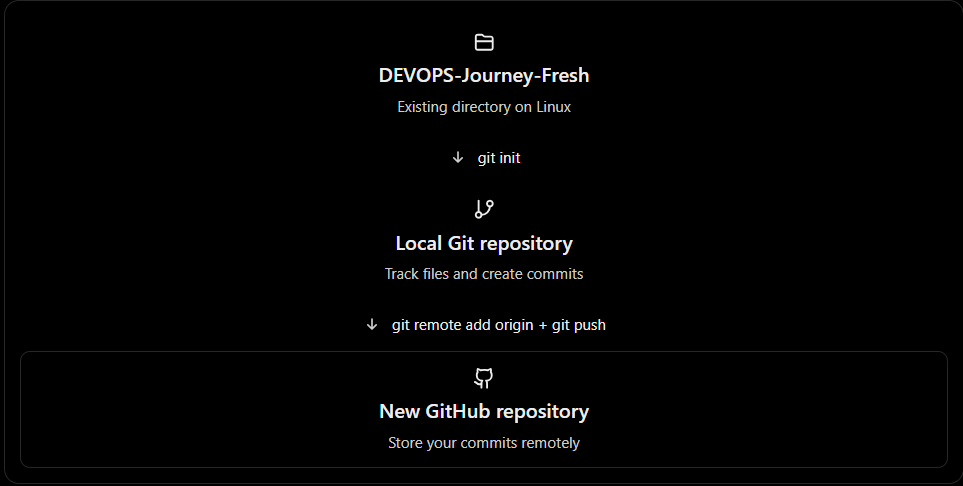
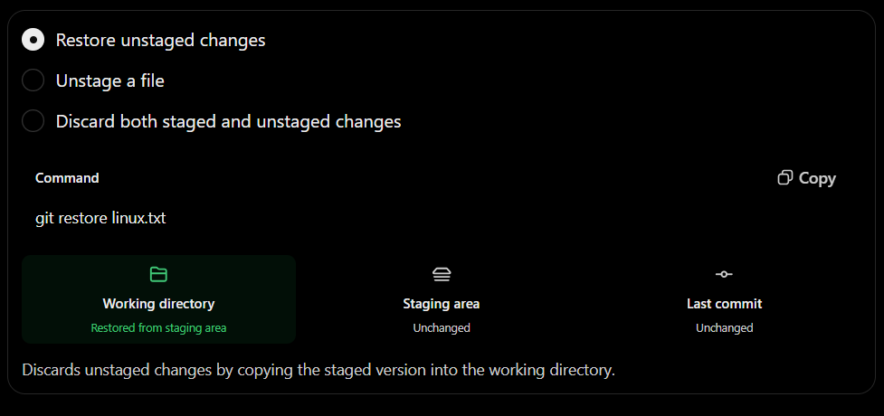
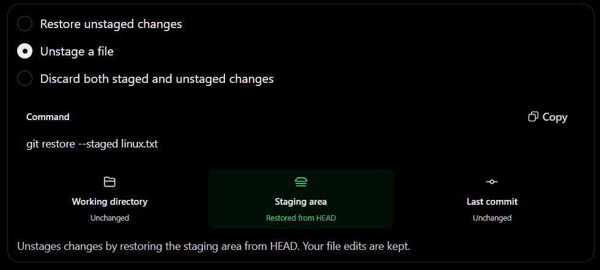
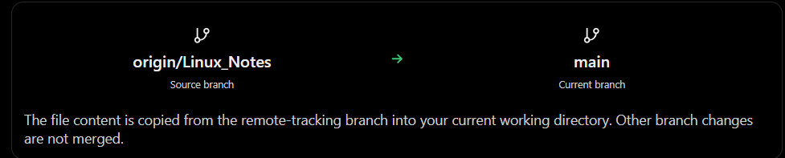

# GIT \&GITHUB

**1.Git Work flow:**

**2. Step 1 — Initialize your fresh local repository**

On your Linux machine:

cd \~/DEVOPS-Journey-Fresh

Check whether Git is already initialized:

git status

If you see fatal: not a git repository, initialize it:

[git init -b main](\\l)

If Git is already initialized, don't run git init again. Check the
current branch instead.

**3. Step 2 — Create a new GitHub repository**

Go to GitHub — Create a new repository.

Configure it as follows:

Setting Value

Repository name DEVOPS-Journey-Fresh

Description My DevOps and Linux learning journey

Visibility Public or Private (your choice)

Add README No

Add .gitignore No

Choose a license None

Important: Leave the new repository empty. This avoids creating an extra
initial commit on GitHub and makes your first push easier.

**4. Step 3 — Create your first local commit**

Back in your Linux terminal:

cd \~/DEVOPS-Journey-Fresh

git status

Review your files before staging them. Make sure no passwords, tokens,
or other secrets are included.

Then, when you're ready to track all the non-ignored files:

git add .

git commit -m "Initial commit - DevOps Journey Fresh"

You now have your first commit on your local main branch.

**5. Step 4 — Connect Linux to your new GitHub repository**

Replace YOUR\_USERNAME with your GitHub username:

git remote add origin
https://github.com/YOUR\_USERNAME/DEVOPS-Journey-Fresh.git

Verify:

git remote -v

Push your local main branch:

git push -u origin main

Git may ask you to authenticate. GitHub requires a supported
authentication method, such as a personal access token or credential
manager for HTTPS.

Once the push succeeds, your project will be on GitHub.

1.  > **What happens when you execute** **git init?**

cd \~/DEVOPS-Journey-Fresh

git init

Git creates a hidden .git directory inside your project folder.

DEVOPS-Journey-Fresh/

├── .git/ ← Git repository information

├── Linux\_Notes/

└── git\_hub/

The .git directory stores information such as commits, branches, and
repository configuration.

Important: git init doesn't automatically create your first commit or
connect your project to GitHub.

**2. Difference between git init and git init -b main**

| **Command**      | **Meaning**                                                            |
| ---------------- | ---------------------------------------------------------------------- |
| git init         | Initializes a repository using Git's configured default branch name    |
| git init -b main | Initializes a repository with the initial branch explicitly named main |

For example, depending on your Git configuration, running:

git init

might show:

Initialized empty Git repository in
/home/user/DEVOPS-Journey-Fresh/.git/

Your initial branch might be called master or main.

But running:

git init -b main

explicitly sets the initial branch name to main.

**3. What if you used git init and your branch is master?**

No problem\! You can rename it:

git branch -M main

Here:

  - git branch — manages branches.

  - \-M — forces a branch rename.

  - main — the new branch name.

Now your initial branch will be named main.

**4. What should you do in your fresh directory?**

Since you're learning Git from scratch, you can run:

cd \~/DEVOPS-Journey-Fresh

[git init](#GitInitMain)

git branch --show-current

git status

Before the first commit, git status will show that there are no commits
yet. The initial branch name can also be seen there.

*If your branch is master, How do you rename it?*

**What should you do in your fresh directory?**

Since you're learning Git from scratch, you can run:

cd \~/DEVOPS-Journey-Fresh

git init

git branch --show-current

git status

Before the first commit, git status will show that there are no commits
yet. The initial branch name can also be seen there.

If your branch is master, rename it:

git branch -M main

If it's already main, no rename is needed.

One more thing: *If you've already
initialized DEVOPS-Journey-Fresh, running git init again normally just
reinitializes the existing repository. It doesn't reset your commit
history.*

In simple words:

  - **git init** = Start tracking this directory with Git.

  - **git init -b main** = Start tracking this directory with Git and
    explicitly choose main as the initial branch.

## GIT Restore Concepts:

In Git, git restore is used to bring a file back to a previous version
or copy a file version from another branch.

It is one of the most important commands to understand when learning
Git, especially because you're practising with DEVOPS-Journey-Fresh.

Let's learn it from the beginning, with practical Linux examples.

**1. First, understand where Git stores your changes**

Before learning git restore, you need to understand these three areas.

git restore primarily operates on your working directory and staging
area. It doesn't automatically change GitHub.

**2. Let's create a practical example**

Suppose you have a file called linux.txt in your fresh repository.

cd \~/DEVOPS-Journey-Fresh

Create a file:

echo "Linux is an operating system" \> linux.txt

Stage and commit:

git add linux.txt

git commit -m "Add Linux introduction"

*Your first committed version is:*

Linux is an operating system

*Now suppose you accidentally replace its content:*

echo "Wrong information" \> linux.txt

*Your current file contains*:

Wrong information

*But your last commit still contains:*

Linux is an operating system

How can you get the original content back?

This is where ***git restore*** becomes useful.

2.  > **Case 1 — Restore changes that have NOT been staged**

Run:

git restore linux.txt

Git replaces the working-directory version with the version from the
staging area.

If you haven't staged anything new, that will normally be the version
from your last commit.

Warning⚠️: git restore linux.txt discards unstaged changes to that file.
Make sure you no longer need them.

**4. Case 2 — Restore a file that has already been staged**

Now let's take another example.

Suppose you modify linux.txt:

echo "Linux supports multiple users" \>\> linux.txt

Then stage it:

git add linux.txt

Now you have staged changes.

But you realize you don't want to commit them yet.

Use:

git restore --staged linux.txt

What happens?

  - Git removes the changes from the staging area.

  - Your modified file content remains in your working directory.

  - Your last commit is unchanged.

So git restore --staged is commonly used to unstage a file.

This does not delete the modifications you've made.

**5. Case 3 — Restore both staged and unstaged changes**

Suppose you edited a file, staged it, and then edited it again.

Now you want to discard all changes to that file and return to the last
committed version.

Run:

git restore --source=HEAD --staged --worktree linux.txt

Here:

  - **--source=HEAD** means use the latest commit on your current
    branch.

  - **--staged** means update the staging area.

  - **--worktree** means update the file in your working directory.

This discards both the staged and unstaged modifications to the file.

**6. Interactive comparison — What will git restore affect?**

Choose the command to understand which area Git modifies.

**7. Case 4 — Restore a deleted file**

*Suppose you accidentally deleted a tracked file:*

rm linux.txt

*If the deletion hasn't been staged, you can recover the file from the
staging area:*

git restore linux.txt

The file appears again.

But remember, this works for a file Git is already tracking. If you
create a new untracked file and delete it before adding or committing
it, Git normally cannot restore it.

**8. Case 5 — Restore a file from another branch**

This example directly relates to your old DEVOPS-Journey repository.

You previously wanted to copy:

Linux\_Notes/linux\_assignment\_questions.txt

from Linux\_Notes to main.

You can do this using git restore.

First, in your original repository:

cd \~/DEVOPS-Journey

git fetch origin

git switch main

Then:

gitrestore--source=origin/Linux\_Notes--Linux\_Notes/linux\_assignment\_questions.txt

After verifying the file, you can stage and commit:

git add Linux\_Notes/linux\_assignment\_questions.txt

git commit -m "Add Linux assignment questions"

git push origin main

Note that the restore command itself doesn't push changes to GitHub.

Also, origin/Linux\_Notes is your locally fetched reference to the
remote branch. Running git fetch origin first updates it.

**9. Case 6 — Restore a file from an older commit**

Suppose your commit history looks like:

A → B → C → D

And commit B contains an older version of linux.txt that you want to
recover.

First, find the commit IDs:

git log --oneline

Example:

e8f42a1 (HEAD -\> main) Update Linux commands

c6d73b2 Add shell scripting

b4a21c9 Add Linux introduction

a19b235 Initial commit

*To restore the file version from commit b4a21c9:*

git restore --source=b4a21c9 -- linux.txt

This replaces the working-directory version of linux.txt with the one
from that older commit.

Your existing commit history remains intact. If you want to make this
restored content the latest version in your branch, stage and commit it.

**10. Difference between Git restore, reset, revert and checkout**

These commands can be confusing because they all relate to previous
versions of your project.

| **Command**  | **Main purpose**                                                      |
| ------------ | --------------------------------------------------------------------- |
| git restore  | Restore file content or unstage changes                               |
| git reset    | Move the current branch pointer, or reset the staging area            |
| git revert   | Create a new commit that reverses changes made by an earlier commit   |
| git checkout | Switch branches or restore file versions (older multipurpose command) |

Important distinction: If a bad commit is
already pushed to a shared GitHub branch, git revert is often safer than
rewriting commit history using git reset.

For example:

git revert e8f42a1

This creates a new commit reversing the selected commit's changes, when
Git can apply that reversal. It doesn't erase the old commit from
history.

**11. Does GitHub have the same restore command?**

GitHub is where your remote Git repository is hosted. You run git
restore in your local Git terminal, not directly on the GitHub website.

For example, if you want to restore an older file version and upload it
to GitHub:

git restore --source=\<commit-id\> -- linux.txt

git add linux.txt

git commit -m "Restore previous Linux file version"

git push origin main

You can also use GitHub's website to inspect commit history, view file
versions, and revert certain pull requests. However, the website doesn't
provide the same general-purpose git restore command interface as your
Linux terminal.

**12. Quick reference — Git restore commands**

| **Requirement**                                | **Command**                                            |
| ---------------------------------------------- | ------------------------------------------------------ |
| Discard unstaged modifications                 | git restore file.txt                                   |
| Remove a file from staging                     | git restore --staged file.txt                          |
| Discard staged and unstaged modifications      | git restore --source=HEAD --staged --worktree file.txt |
| Recover an unstaged deletion of a tracked file | git restore file.txt                                   |
| Copy file from another branch                  | git restore --source=branch\_name -- file.txt          |
| Restore file version from older commit         | git restore --source=commit\_id -- file.txt            |
| View current file modifications                | git diff -- file.txt                                   |
| View staged modifications                      | git diff --staged -- file.txt                          |

**One rule I recommend while you're learning Git**

Before running any restore command, always check:

git status

git diff

git diff --staged

These three commands help you understand which changes are in your
working directory and which changes are staged.

Final concept to remember:

  - **git restore** = Bring back file content or unstage changes.

  - **git commit** = Save a version in local Git history.

  - **git push** = Upload your local commits to GitHub.

  - **git revert** = Reverse an earlier committed change with a new
    commit.

The most important distinction is between restoring a file and reversing
a commit. They are not the same operation.
