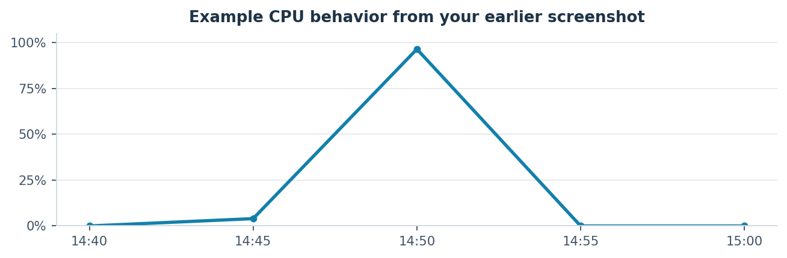
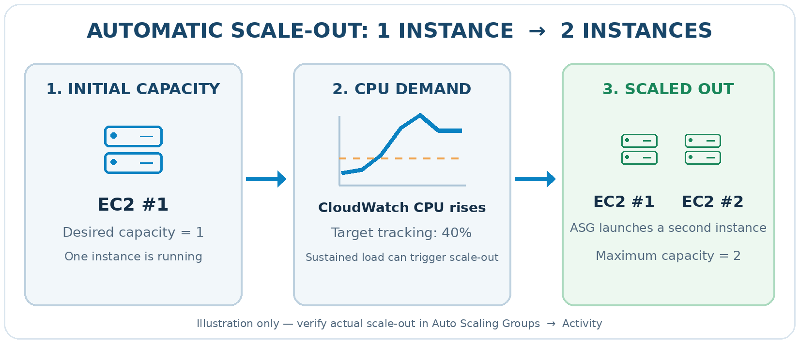
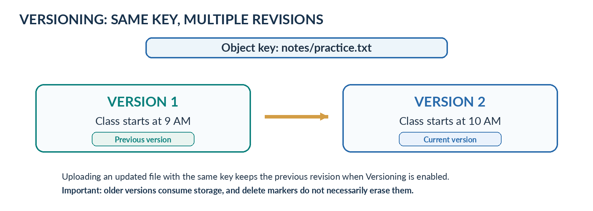
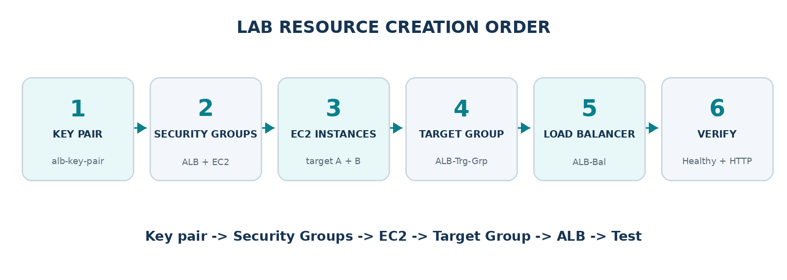

A complete beginner-friendly setup using your resource names, visual
diagrams, Nginx target instances, and health-check verification.

# Learning goal

  - Create an Application Load Balancer that receives HTTP requests on
    port 80.

  - Run two EC2 instances with Nginx and register them in a Target
    Group.

  - Verify that both targets are Healthy and test traffic distribution.

# Architecture — What we are building

Figure 1. Browser → ALB → Target Group → two Nginx EC2 instances.

# Step 1 — Create Key Pair

Go to EC2 → Network & Security → Key Pairs → Create key pair.

| **Setting**             | **Value**    |
| ----------------------- | ------------ |
| Name                    | alb-key-pair |
| Key pair type           | RSA          |
| Private key file format | .pem         |

Click Create key pair and save the downloaded .pem file securely. The
key pair provides SSH access to EC2; the ALB does not use it.

# Step 2 — Create two Security Groups

Go to EC2 → Network & Security → Security Groups → Create security
group. Use the same VPC for both groups and for your EC2 instances.

## Security Group 1 — ALB: alb-sec-grp

| **Direction** | **Type / Port** | **Source or destination** |
| ------------- | --------------- | ------------------------- |
| Inbound       | HTTP / 80       | Anywhere-IPv4 (0.0.0.0/0) |
| Outbound      | All traffic     | Default allowed           |

Purpose: allow internet users to reach the load balancer through HTTP.

## Security Group 2 — EC2: ec2-target-sec-grp

| **Direction** | **Type / Port** | **Source or destination**           |
| ------------- | --------------- | ----------------------------------- |
| Inbound       | SSH / 22        | My IP (IPv4 /32)                    |
| Inbound       | HTTP / 80       | alb-sec-grp (Security Group source) |
| Outbound      | All traffic     | Default allowed                     |

For the HTTP inbound rule, choose Custom as the source and select the
ALB Security Group, rather than allowing all internet traffic directly
to EC2.

Figure 2. Port 80 follows the ALB → EC2 Security Group path; SSH goes
directly from your own IP to EC2.

# Step 3 — Launch two EC2 target instances

Go to EC2 → Instances → Launch instances. Create one instance at a time
with these settings:

| **Setting**       | **Instance A**     | **Instance B**     |
| ----------------- | ------------------ | ------------------ |
| Name              | alb-target-A       | alb-target-B       |
| AMI               | Ubuntu Server      | Ubuntu Server      |
| Instance type     | t3.micro           | t3.micro           |
| Key pair          | alb-key-pair       | alb-key-pair       |
| Security Group    | ec2-target-sec-grp | ec2-target-sec-grp |
| Availability Zone | ap-south-2a        | ap-south-2b        |

Use subnets from the same VPC. For an introductory lab, public subnets
with public IPv4 addresses simplify SSH access and package installation.
Both EC2 targets must be Running.

## Install Nginx on each instance

Connect with SSH, or paste the following into User Data when launching
each instance:

<table>
<tbody>
<tr class="odd">
<td>#!/bin/bash 
sudo apt update -y 
sudo apt install nginx -y 
sudo systemctl enable --now nginx</td>
</tr>
</tbody>
</table>

To show which target handles a request, make each Nginx home page
unique:

**On alb-target-A:**

|                                                                                     |
| ----------------------------------------------------------------------------------- |
| echo "\<h1\>Hello from EC2 Instance A\!\</h1\>" | sudo tee /var/www/html/index.html |

**On alb-target-B:**

|                                                                                     |
| ----------------------------------------------------------------------------------- |
| echo "\<h1\>Hello from EC2 Instance B\!\</h1\>" | sudo tee /var/www/html/index.html |

Nginx should now serve HTTP on port 80 on both EC2 instances.

# Step 4 — Create the Target Group

Go to EC2 → Target Groups → Create target group.

| **Setting**           | **Value**                 |
| --------------------- | ------------------------- |
| Target type           | Instances                 |
| Target group name     | ALB-Trg-Grp               |
| Protocol / Port       | HTTP / 80                 |
| IP address type       | IPv4                      |
| VPC                   | Same VPC as the instances |
| Health check protocol | HTTP                      |
| Health check path     | /                         |

Choose Next. On Register targets, select alb-target-A and alb-target-B,
keep port 80, select Include as pending below, then Create target group.

The ALB will send periodic health checks to / on each registered
instance.

# Step 5 — Create the Application Load Balancer

Go to EC2 → Load Balancers → Create load balancer → Application Load
Balancer.

| **Setting**             | **Value**                          |
| ----------------------- | ---------------------------------- |
| Load balancer name      | ALB-Bal                            |
| Scheme                  | Internet-facing                    |
| IP address type         | IPv4                               |
| VPC                     | Same VPC as EC2 targets            |
| Availability Zones      | ap-south-2a and ap-south-2b        |
| Subnets                 | A public subnet in each enabled AZ |
| Security Group          | alb-sec-grp                        |
| Listener                | HTTP : 80                          |
| Forward to target group | ALB-Trg-Grp                        |
| Weight                  | 1 (100%)                           |
| Target group stickiness | Disabled                           |

Choose Create load balancer. Wait until the ALB state becomes Active.

Important from your previous lab: If target A is in ap-south-2a but the
ALB only enables ap-south-2b and ap-south-2c, target A appears Unused.
Enable both AZs that contain the target instances.

# Step 6 — Verify Target Group health

Open EC2 → Target Groups → ALB-Trg-Grp → Targets and check the status of
both registered instances.

Figure 3. Expected final target health: two Healthy targets and zero
Unused targets.

If Unused: enable its AZ on the ALB. If Unhealthy: check EC2 is Running,
Nginx serves HTTP:80, the EC2 Security Group permits alb-sec-grp, and
the health check path is /.

# Step 7 — Test load balancing

Copy the ALB DNS name from EC2 → Load Balancers → ALB-Bal → Details.
Open the HTTP (not HTTPS) URL in your browser.

From your local Ubuntu VirtualBox terminal, run:

|                                                           |
| --------------------------------------------------------- |
| curl http://ALB-Bal-93702691.ap-south-2.elb.amazonaws.com |

To send ten requests and compare which EC2 instance responds:

<table>
<tbody>
<tr class="odd">
<td>for i in {1..10}; do 
curl -s http://ALB-Bal-93702691.ap-south-2.elb.amazonaws.com 
echo 
done</td>
</tr>
</tbody>
</table>

Example response bodies (the actual order is not guaranteed):

<table>
<tbody>
<tr class="odd">
<td>&lt;h1&gt;Hello from EC2 Instance A!&lt;/h1&gt; 
&lt;h1&gt;Hello from EC2 Instance B!&lt;/h1&gt; 
&lt;h1&gt;Hello from EC2 Instance A!&lt;/h1&gt;</td>
</tr>
</tbody>
</table>

If you receive responses from both A and B, traffic is reaching both
healthy targets. One HTTP 200 response alone does not prove both targets
are healthy.

# Quick revision — Creation sequence

Figure 4. Recommended resource creation sequence for this lab.

# Simple analogy

The ALB is the receptionist; the Target Group is the list of available
employees; EC2 instances are the employees; and Security Groups are the
entry rules controlling who can speak to whom.

# Clean up after your lab

An ALB incurs ongoing charges even with little traffic. When the lab is
complete, remove the ALB, Target Group and any EC2 instances you no
longer need. Keep reusable key pairs and Security Groups if you plan to
use them again.
