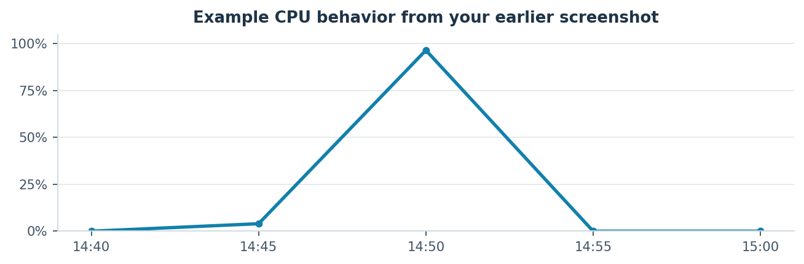

**Goal: Practice CPU-based automatic scaling using EC2, stress-ng, and
CloudWatch.**

> **1.** Launch one EC2 instance through an ASG.
> 
> **2.** Generate high CPU usage using stress-ng.
> 
> **3.** Observe CloudWatch CPU utilization.
> 
> **4.** Watch the ASG automatically launch a second instance.
> 
> **5.** Stop CPU load and observe automatic scale-in.

# **Step 1 — Create Security Group**

Go to EC2 → Security Groups → Create security group.

| **Setting**         | **Value**    |
| ------------------- | ------------ |
| Security group name | ASG-SG       |
| Description         | ASG practice |
| VPC                 | Default VPC  |

Add these inbound rules:

| **Type** | **Port** | **Source**                |
| -------- | -------- | ------------------------- |
| SSH      | 22       | My IP (IPv4)              |
| HTTP     | 80       | Anywhere-IPv4 (0.0.0.0/0) |

Keep the default outbound rule allowing all traffic.

Click Create security group.

If you already have a suitable Security Group, reuse it and verify its
inbound rules.

# **Step 2 — Create Launch Template**

Go to EC2 → Launch Templates → Create launch template.

| **Setting**                        | **Value**                                       |
| ---------------------------------- | ----------------------------------------------- |
| Launch template name               | ASG-LT                                          |
| Auto Scaling guidance              | Check                                           |
| AMI                                | Ubuntu Server 26.04 LTS (64-bit x86, Canonical) |
| Instance type                      | t3.micro                                        |
| Key pair                           | Existing key pair                               |
| Network settings → Security groups | ASG-SG                                          |
| Advanced network configuration     | Leave default                                   |
| Storage                            | Keep default                                    |
| Purchasing option                  | Don't include in launch template                |
| Resource tags                      | Skip                                            |

Ubuntu Server 26.04 LTS is available as an official Canonical AWS AMI.

## **Add User Data**

Go to Advanced details → User data and paste your updated script exactly
as requested:

<table>
<tbody>
<tr class="odd">
<td>
#!/bin/bash

sudo apt update -y

sudo apt install nginx stress-ng -y

sudo systemctl enable --now nginx

echo "&lt;h1&gt;Hello from Ubuntu ASG!&lt;/h1&gt;" &gt; /var/www/html/index.html
</td>
</tr>
</tbody>
</table>

Explanation:

| **Command**                         | **Purpose**                                   |
| ----------------------------------- | --------------------------------------------- |
| sudo apt update -y                  | Refresh package information                   |
| sudo apt install nginx stress-ng -y | Install Nginx and the CPU stress tool         |
| sudo systemctl enable --now nginx   | Enable Nginx at boot and start it immediately |
| echo ... \> index.html              | Create a simple web page                      |

|                                                                                                                |
| -------------------------------------------------------------------------------------------------------------- |
| Note: EC2 User Data scripts run as the root user, so sudo is not necessary, but your commands will still work. |

Click Create launch template.

# **Step 3 — Create Auto Scaling Group**

Go to EC2 → Auto Scaling Groups → Create Auto Scaling group.

## **A. Choose launch template**

| **Setting**     | **Value** |
| --------------- | --------- |
| ASG name        | ASG-Test  |
| Launch template | ASG-LT    |

Click Next.

## **B. Instance launch options**

| **Setting**   | **Value**                                                  |
| ------------- | ---------------------------------------------------------- |
| Instance type | Use launch template                                        |
| VPC           | Default VPC                                                |
| Subnets       | Two default public subnets in different Availability Zones |

Ensure both selected subnets have internet gateway access and
automatically assign public IPv4 addresses. This lets you leave Advanced
network configuration at its defaults.

Click Next.

## **C. Integrate with other services**

| **Setting**    | **Value**        |
| -------------- | ---------------- |
| Load balancing | No load balancer |
| Health checks  | EC2              |
| Other settings | Keep default     |

Click Next.

## **D. Configure group size and automatic scaling**

| **Setting**      | **Value**                             |
| ---------------- | ------------------------------------- |
| Desired capacity | 1                                     |
| Minimum capacity | 1                                     |
| Maximum capacity | 2                                     |
| Scaling policy   | Target tracking scaling policy        |
| Policy name      | Keep default, or CPU-Scaling if blank |
| Metric type      | Average CPU utilization               |
| Target value     | 40                                    |
| Instance warmup  | 300 seconds                           |
| Disable scale in | Unchecked                             |

Click Next, skip optional notifications and tags, review and select
Create Auto Scaling group.

# **Step 4 — Verify the first EC2 instance**

Go to EC2 → Instances.

Confirm that the ASG automatically created one running instance.

Connect through SSH using your existing key pair.

Run:

|                          |
| ------------------------ |
| cloud-init status --wait |

This ensures User Data has finished executing.

Optionally, test Nginx in your browser using the instance's public IPv4
address:

|                       |
| --------------------- |
| http://YOUR-PUBLIC-IP |

Expected output: Hello from Ubuntu ASG\!

# **Step 5 — Generate high CPU utilization**

In the EC2 terminal, run:

|                                                 |
| ----------------------------------------------- |
| stress-ng --cpu 2 --cpu-load 100 --timeout 300s |

| **Parameter**   | **Meaning**          |
| --------------- | -------------------- |
| \--cpu 2        | Start 2 CPU workers  |
| \--cpu-load 100 | Target 100% CPU load |
| \--timeout 300s | Run for 5 minutes    |

To observe CPU usage on the instance, open another SSH session and run:

|     |
| --- |
| top |

# **Step 6 — Observe CPU usage in CloudWatch**

Navigate to EC2 → Instances → Select instance → Monitoring → CPU
utilization.

You should observe CPU usage rising significantly.

CPU utilization spiked to approximately 96.46% during your earlier
experiment.

# **Step 7 — Observe automatic scale-out**

Go to EC2 → Auto Scaling Groups → ASG-Test → Activity.

If the policy detects sufficient sustained CPU utilization, the ASG will
launch another instance.

| **Sequence**                         | **What you should see**                               |
| ------------------------------------ | ----------------------------------------------------- |
| Initially                            | 1 EC2 instance running                                |
| CloudWatch CPU utilization increases | Target tracking responds to sustained high CPU        |
| After successful scale-out           | EC2 \#1 (original) + EC2 \#2 (automatically launched) |

|                                                                                                                                                                                 |
| ------------------------------------------------------------------------------------------------------------------------------------------------------------------------------- |
| Important: Because default EC2 monitoring typically publishes CPU metrics every five minutes, one 300-second stress test may not be sufficient for the scaling policy to react. |

If scale-out does not happen, run the same stress command consecutively
again to keep CPU usage elevated over additional monitoring periods.

# **Step 8 — Observe automatic scale-in**

After the stress command finishes, CPU utilization should decrease.

> **1.** Open EC2 → Instances → Monitoring and check CPU utilization.
> 
> **2.** Open Auto Scaling Groups → ASG-Test → Activity.
> 
> **3.** Observe the scale-in activity when the policy determines fewer
> instances are needed.
> 
> **4.** Confirm that the ASG eventually returns to one instance.

With your minimum capacity of 1, the ASG should not automatically scale
below one instance.

Scale-in can take several additional minutes because of CloudWatch
metrics, alarms, and your 300-second warmup.

# **Step 9 — Clean up**

Once you finish observing the scaling behavior:

> **1.** Delete the ASG-Test Auto Scaling Group and its instances.
> 
> **2.** Keep your existing key pair and Security Group for future labs.
> 
> **3.** Keep or delete ASG-LT depending on whether you want to reuse
> it.

Be aware that t3.micro instances run in Unlimited CPU credit mode by
default, which may incur surplus CPU-credit charges under sustained
load. If avoiding those charges is your priority, Standard CPU credit
mode is an option, but CPU throttling may affect this particular
experiment.

# **Your final hands-on checklist**

> ☐ Security Group with SSH and HTTP inbound rules
> 
> ☐ Launch Template with Ubuntu 26.04 LTS
> 
> ☐ User Data installs Nginx and stress-ng
> 
> ☐ ASG with desired/min/max capacity 1/1/2
> 
> ☐ CPU target 40%, instance warmup 300 seconds
> 
> ☐ Run stress-ng at 100% for 300 seconds
> 
> ☐ Observe CPU utilization increase
> 
> ☐ Observe second instance launch
> 
> ☐ Observe scale-in back to one instance
> 
> ☐ Clean up resources

|                                                                                                                                                                                                                                                                                                                    |
| ------------------------------------------------------------------------------------------------------------------------------------------------------------------------------------------------------------------------------------------------------------------------------------------------------------------ |
| One last tip: If you’re updating your existing ASG-LT rather than creating a fresh template, create a new Launch Template version with the updated User Data, then change ASG-Test to use that version. Existing instances won’t automatically rerun the modified User Data; it applies when new instances launch. |
