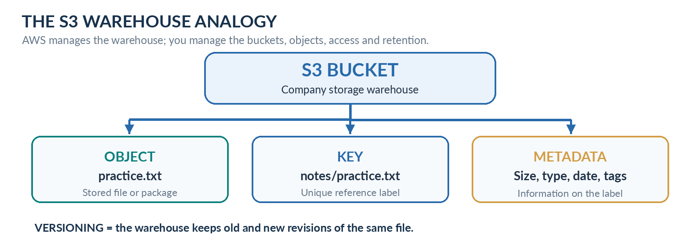
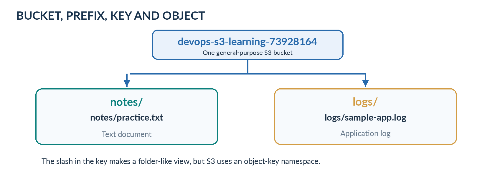
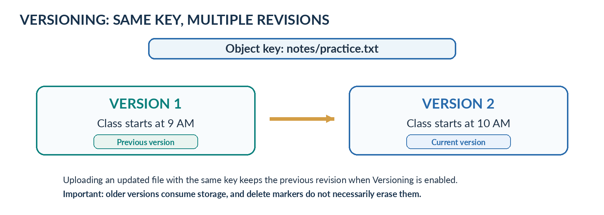
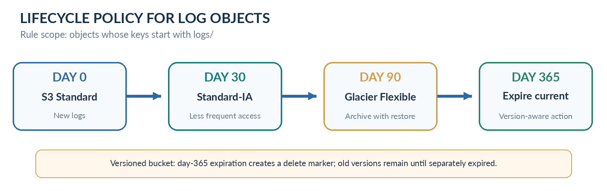

**DEVOPS LEARNING SERIES / AMAZON WEB SERVICES**

AMAZON S3

**Complete Beginner's Guide + Hands-On Assignment**

Object Storage • Buckets • Objects & Keys • Storage Classes • Versioning
• Lifecycle Rules

Warehouse analogy: buckets store objects; keys locate them; metadata
describes them.

<table>
<tbody>
<tr class="odd">
<td>
<strong>LEARNING OUTCOME</strong>

Understand why S3 exists, explain its six core concepts, and build a private storage bucket with version recovery and automated log retention.
</td>
</tr>
</tbody>
</table>

## Your DevOps assignment

A team lead asks you to organize company course notes and application
logs in Amazon S3. You must keep earlier document revisions for recovery
and automatically archive aging logs. Your evidence is a working bucket,
a recovered version, and a configured Lifecycle rule.

| **LAB AT A GLANCE**   | **YOUR SETUP**                                                          |
| --------------------- | ----------------------------------------------------------------------- |
| **Service**           | Amazon Simple Storage Service (S3)                                      |
| **Access method**     | AWS Management Console; Ubuntu terminal only for sample log generation  |
| **Bucket type**       | General purpose, private, Versioning enabled                            |
| **Object paths**      | notes/practice.txt and logs/sample-app.log                              |
| **Lifecycle example** | Day 30 Standard-IA → Day 90 Glacier Flexible Retrieval → Day 365 expire |

# 1\. Why was Amazon S3 introduced?

Companies traditionally stored images, documents, application data, logs
and backups on local disks, file servers, or physical backup media.
These solutions still have valid uses, but organizations must plan
capacity, replace hardware, protect copies and manage failures. S3
offers AWS-managed, scalable object storage as an alternative to
maintaining all that storage infrastructure yourself.

| **BEFORE S3**        | **COMMON CHALLENGE**                       | **WHAT S3 HELPS WITH**                         |
| -------------------- | ------------------------------------------ | ---------------------------------------------- |
| **Hard disks**       | Limited capacity and location-bound access | Scale storage without buying physical disks    |
| **File servers**     | Hardware upkeep and failure planning       | AWS manages the object-storage infrastructure  |
| **Backup tapes**     | Slow handling and recovery workflows       | Store durable backups with programmatic access |
| **Manual expansion** | Demand grows unpredictably                 | Store more objects as needed                   |

<table>
<tbody>
<tr class="odd">
<td>
<strong>IMPORTANT DISTINCTION</strong>

S3 is object storage, not a Linux block disk or a conventional mounted filesystem. You normally access it using the AWS Console, CLI, SDKs or APIs.
</td>
</tr>
</tbody>
</table>

# 2\. What is S3, and when should you use it?

Amazon S3 (Simple Storage Service) stores data as objects inside
buckets. Typical examples include documents, website images, user
uploads, application logs, data exports and backups.

| **USE CASE**           | **EXAMPLE**                                             |
| ---------------------- | ------------------------------------------------------- |
| **Website media**      | Store product images or user-uploaded photos.           |
| **Operations**         | Retain application logs for audits and troubleshooting. |
| **Backups**            | Store copies of databases, documents, and exports.      |
| **Learning platform**  | Keep training notes and PDFs in controlled storage.     |
| **Long-term archives** | Use lifecycle policies to transition aging objects.     |

# 3\. S3 warehouse analogy

Imagine a warehouse operated by AWS. You rent a labeled storage area
(bucket), place packages inside (objects), and use a unique address
label (key) to find each package. Metadata describes it. Versioning
keeps revised copies, while lifecycle rules tell the warehouse manager
when to move or expire items.

Example bucket with two key prefixes. The object key is the entire
path-like string.

# 4\. Six core S3 concepts

## Concept 1 — Bucket

A bucket is the top-level container for objects. You choose an AWS
Region when you create it. In the common shared global naming namespace,
bucket names must be unique across AWS accounts within an AWS partition;
AWS also offers an account regional namespace for eligible
general-purpose buckets. The bucket remains associated with its chosen
Region.

Example: **devops-s3-learning-73928164** (illustrative name;
availability is not guaranteed).

<table>
<tbody>
<tr class="odd">
<td>
<strong>WAREHOUSE MEMORY HOOK</strong>

Bucket = your named warehouse. Region = which AWS geographic area hosts the bucket. Bucket name is not an individual object path.
</td>
</tr>
</tbody>
</table>

## Concept 2 — Object

An object is the stored item. It consists of object data and metadata; a
versioned object has a version ID identifying that particular revision.
Examples: report.pdf, photo.jpg and application.log.

## Concept 3 — Key

An object key is the complete name of an object inside a bucket. For
example, images/banner.png identifies the banner image. The images/
portion is a prefix that looks like a folder; in a general-purpose S3
bucket the objects are identified by keys rather than a traditional
hierarchical filesystem.

| **CONCEPT**     | **EXAMPLE**                 | **MEANING**                                |
| --------------- | --------------------------- | ------------------------------------------ |
| **Bucket**      | devops-s3-learning-73928164 | Storage container                          |
| **Key**         | notes/practice.txt          | Complete object name                       |
| **Object data** | Today I learned Amazon S3.  | File contents                              |
| **Metadata**    | Content-Type: text/plain    | Information about an object                |
| **Version ID**  | AWS-generated identifier    | Specific revision if Versioning is enabled |

## Concept 4 — Storage Classes

Different files require different access speeds and storage economics.
S3 offers multiple classes; the best one depends on access frequency,
retrieval requirements, object size and minimum storage duration
charges.

| **CLASS**                      | **EASY ANALOGY**            | **TYPICAL USE**                          |
| ------------------------------ | --------------------------- | ---------------------------------------- |
| **S3 Standard**                | Front warehouse shelf       | Frequently used or new files             |
| **Intelligent-Tiering**        | Smart shelf manager         | Unpredictable or changing access         |
| **Standard-IA**                | Back storage shelf          | Infrequently used, rapid retrieval       |
| **Glacier Instant Retrieval**  | Fast archive section        | Rarely accessed but immediate reads      |
| **Glacier Flexible Retrieval** | Archive with retrieval desk | Long-term archives; restore often needed |
| **Glacier Deep Archive**       | Deep storage vault          | Very rarely accessed, hours to restore   |

<table>
<tbody>
<tr class="odd">
<td>
<strong>NOTE</strong>

Glacier is a family of storage classes. Glacier Instant Retrieval supports immediate access; Glacier Flexible Retrieval and Deep Archive require archival retrieval workflows. Retrieval and minimum-duration charges matter.
</td>
</tr>
</tbody>
</table>

## Concept 5 — Versioning

When Versioning is enabled, uploading an updated file with the same key
retains its earlier version. This helps recover from overwrites and
certain accidental deletions. Older versions still occupy storage and
can incur charges.

Both uploads share notes/practice.txt; only the newer version is
current.

If a user deletes a versioned object without specifying a version ID, S3
normally creates a delete marker. Older data versions are retained until
explicitly removed or expired by an appropriate lifecycle policy.

## Concept 6 — Lifecycle Rules

S3 Lifecycle automatically applies age-based actions to matching
objects. For this assignment, only log objects are included in the rule.
Newly uploaded logs remain in S3 Standard, then age into other storage
classes and eventually expire.

The transition times are measured from each matching object’s creation
date.

<table>
<tbody>
<tr class="odd">
<td>
<strong>VERY IMPORTANT</strong>

For Versioning-enabled buckets, expiration of the current version generally creates a delete marker, not a permanent deletion of all versions. Add a separate noncurrent-version expiration policy if permanent cleanup of old revisions is required.
</td>
</tr>
</tbody>
</table>

<table>
<tbody>
<tr class="odd">
<td>
<strong>COST CONSIDERATION</strong>

Under current S3 Lifecycle defaults, objects smaller than 128 KB normally do not transition to any storage class. This guide creates a sample log larger than that threshold. Standard-IA and archival classes also have minimum storage-duration and retrieval/transition pricing considerations.
</td>
</tr>
</tbody>
</table>

# 5\. Practical scenario — Team lead assignment

> *“Our company operates a training platform. Store course notes and
> application logs in S3. Protect document revisions against overwrites,
> archive logs as they age, and keep the data private. Show me the
> bucket, the versions and the lifecycle policy.”*

| **SETTING**            | **LAB VALUE**                                                       |
| ---------------------- | ------------------------------------------------------------------- |
| **Bucket name**        | devops-s3-learning-\<unique-id\>                                    |
| **Bucket type**        | General purpose                                                     |
| **Public access**      | Block all public access                                             |
| **Object Ownership**   | ACLs disabled                                                       |
| **Default encryption** | SSE-S3                                                              |
| **Versioning**         | Enabled                                                             |
| **Folders / prefixes** | notes/ and logs/                                                    |
| **Lifecycle rule**     | Logs-Lifecycle-Rule; prefix logs/                                   |
| **Transitions**        | Standard-IA after 30 days, Glacier Flexible Retrieval after 90 days |
| **Expiration**         | Current version after 365 days                                      |

# 6\. AWS implementation — Console walkthrough

## Step 1 — Create a private S3 bucket

Go to AWS Console → S3 → General purpose buckets → Create bucket. Enter
an available bucket name such as devops-s3-learning-\<unique-id\>
(replace the placeholder with your own numbers). Select your chosen AWS
Region.

  - > Keep Object Ownership set to ACLs disabled and “Block all public
    > access” selected.

  - > Enable Bucket Versioning. Keep default server-side encryption
    > (SSE-S3).

  - > Choose Create bucket, then open it from the bucket list.

<table>
<tbody>
<tr class="odd">
<td>
<strong>ANALOGY</strong>

You have opened a named warehouse and told security not to accept public visitors. Your warehouse manager will preserve updated document copies.
</td>
</tr>
</tbody>
</table>

## Step 2 — Create prefixes and upload your first object

In the bucket Objects tab, choose Create folder. Create notes/ and
logs/. These are displayed as folders in the Console but correspond to
prefixes in object keys.

<table>
<tbody>
<tr class="odd">
<td>devops-s3-learning-&lt;unique-id&gt;/ 
notes/ 
logs/</td>
</tr>
</tbody>
</table>

On your computer, create practice.txt with the following contents. Open
notes/ → Upload → Add files → Upload, leaving the storage class at
Standard.

<table>
<tbody>
<tr class="odd">
<td>Today I learned Amazon S3. 
My class starts at 9 AM.</td>
</tr>
</tbody>
</table>

Expected object key: **notes/practice.txt**

## Step 3 — Inspect object details and metadata

Open notes/practice.txt from the Objects tab. Review its key, size,
storage class, last-modified timestamp, Version ID and metadata. These
details are the digital equivalent of package labels in a warehouse.

## Step 4 — Test Versioning by overwriting the same key

Edit practice.txt locally and change “9 AM” to “10 AM”. Upload the
edited file again to notes/ with the same filename and object key.

<table>
<tbody>
<tr class="odd">
<td>Today I learned Amazon S3. 
My class starts at 10 AM.</td>
</tr>
</tbody>
</table>

Enable Show versions in the Objects view, or open the object’s Versions
view. Verify that the current version contains 10 AM and an earlier
version contains 9 AM.

| **VERSION**   | **CONTENT**           | **STATUS**            |
| ------------- | --------------------- | --------------------- |
| **Version 1** | Class starts at 9 AM  | Previous / noncurrent |
| **Version 2** | Class starts at 10 AM | Current               |

Recovery practice: download the earlier version, review it, then upload
its contents again using the same key if you want that content to become
current. In a versioned bucket, deleting a current object can instead
create a delete marker; inspect all versions before permanently removing
data.

## Step 5 — Observe the storage class

Open practice.txt and inspect Storage class. For this lab it should be
S3 Standard. The other classes are important for understanding cost and
retrieval, but keep the training note in Standard while you practice
version recovery.

## Step 6 — Generate and upload a sample application log

If you have an Ubuntu shell, generate a demonstration log larger than
128 KB. This is synthetic training data, not real application production
logs:

<table>
<tbody>
<tr class="odd">
<td>for i in $(seq 1 10000); do 
echo "INFO: Training application request completed" 
done &gt; sample-app.log 
 
ls -lh sample-app.log</td>
</tr>
</tbody>
</table>

Upload sample-app.log under logs/ in your S3 bucket. Its complete object
key will be logs/sample-app.log.

<table>
<tbody>
<tr class="odd">
<td>
<strong>WHY A LARGER FILE?</strong>

Most new S3 Lifecycle configurations do not transition objects smaller than 128 KB by default. A larger sample avoids that default restriction for this exercise.
</td>
</tr>
</tbody>
</table>

## Step 7 — Configure the Lifecycle rule

Go to S3 → your bucket → Management → Lifecycle rules → Create lifecycle
rule. Name it Logs-Lifecycle-Rule. Select the option to limit the scope
using filters, and enter Prefix: logs/.

Select Transition current versions of objects between storage classes
and enter:

| **AGE OF OBJECT** | **ACTION**                                  |
| ----------------- | ------------------------------------------- |
| **30 days**       | Transition to S3 Standard-IA                |
| **90 days**       | Transition to S3 Glacier Flexible Retrieval |
| **365 days**      | Expire current object versions              |

Review and create the rule. These timings apply to objects starting at
the time each object is created—not the time you create the rule.
Lifecycle actions can occur asynchronously after an object becomes
eligible.

<table>
<tbody>
<tr class="odd">
<td>
<strong>VERSIONING WARNING</strong>

Because bucket Versioning is enabled, day-365 current-version expiration normally adds a delete marker; it does not remove old versions permanently. NoncurrentVersionExpiration is a different lifecycle action, and permanent removal is irreversible.
</td>
</tr>
</tbody>
</table>

## Step 8 — Verify that the Lifecycle rule exists

Return to the bucket Management tab and check that Logs-Lifecycle-Rule
is Enabled, filtered to logs/, and contains the 30-day, 90-day and
365-day actions. You cannot directly watch 30 days of aging happen
immediately during a same-day lab.

## Step 9 — Clean up the training resources

When you have finished, remove all versions and delete markers from the
sample objects, then empty and delete the bucket if you no longer need
it. In a versioned bucket, removing only the current visible object is
not sufficient to empty the bucket. Deleting archival or
minimum-duration objects early may still result in charges.

# 7\. Troubleshooting guide

| **SYMPTOM**                                  | **FIRST CHECK**                                               |
| -------------------------------------------- | ------------------------------------------------------------- |
| **Bucket name already exists**               | Try another name or the supported account regional namespace. |
| **Access denied during upload**              | Check your IAM permissions and bucket access controls.        |
| **Only one version is visible**              | Enable Show versions; confirm same key and versioning state.  |
| **A “folder” seems empty**                   | Verify the full prefix and bucket Region.                     |
| **Lifecycle rule has not moved the object**  | Check object age, prefix filter and object-size threshold.    |
| **Small logs do not transition**             | Default restriction for objects under 128 KB.                 |
| **“Deleted” object has previous versions**   | Check delete markers and noncurrent versions.                 |
| **Archived log cannot download immediately** | Glacier Flexible Retrieval may need a restore operation.      |

# 8\. Assignment completion checklist

□ 01. Create a general-purpose S3 bucket.

□ 02. Select the intended AWS Region.

□ 03. Leave Block Public Access enabled.

□ 04. Enable S3 Versioning.

□ 05. Create notes/ and logs/ prefixes.

□ 06. Upload practice.txt into notes/.

□ 07. Inspect its key and metadata.

□ 08. Edit and re-upload practice.txt using the same key.

□ 09. View both object version IDs.

□ 10. Identify current and noncurrent revisions.

□ 11. Inspect the storage class.

□ 12. Upload sample-app.log larger than 128 KB.

□ 13. Create Logs-Lifecycle-Rule scoped to logs/.

□ 14. Set day-30 Standard-IA and day-90 Glacier Flexible Retrieval
transitions.

□ 15. Set day-365 current-version expiration and explain delete markers.

□ 16. Verify the rule and clean up lab objects/versions afterward.

# 9\. Interview preparation

## Main interview question

**“What is Amazon S3, and how did you use it in your practical DevOps
project?”**

**Sample answer:**

Amazon S3 is AWS object storage for files such as documents, images,
logs and backups. In my learning project, I created a private
general-purpose bucket, organized documents and logs using object keys,
and enabled Versioning so older document revisions could be recovered. I
then configured an S3 Lifecycle rule for the logs/ prefix, moving
current log versions to Standard-IA after 30 days and Glacier Flexible
Retrieval after 90 days, and expiring current versions after 365 days. I
verified the rule and learned that expiration in a versioned bucket
usually creates a delete marker rather than deleting previous versions.

## Follow-up questions and short answers

| **QUESTION**                                       | **GOOD ANSWER**                                                                                   |
| -------------------------------------------------- | ------------------------------------------------------------------------------------------------- |
| **1. Bucket vs object?**                           | Bucket holds objects; object stores data with metadata.                                           |
| **2. What is a key?**                              | The complete name of an object, e.g., logs/app.log.                                               |
| **3. Why Versioning?**                             | Recover overwritten or deleted current objects and retain revisions.                              |
| **4. Standard vs Standard-IA?**                    | Both allow fast retrieval; IA targets infrequent access and has retrieval/minimum-duration costs. |
| **5. Does a lifecycle expiry erase all versions?** | No. Current expiration usually creates a delete marker when Versioning is enabled.                |
| **6. Can a new log transition immediately?**       | Not under a 30-day age rule; it must first reach eligibility.                                     |

# 10\. Self-test question

You upload notes/practice.txt to a bucket with Versioning enabled. You
then upload an updated file with the same key. What happens to the
original file?

  - > A. S3 permanently deletes the original revision.

  - > B. S3 keeps the older revision and makes the new version current.

  - > C. S3 automatically moves the older revision to Glacier.

  - > D. S3 creates a new bucket.

**Answer: B. The previous version is preserved, and the latest upload
becomes current.**

Official reference: AWS S3 User Guide —
https://docs.aws.amazon.com/AmazonS3/latest/userguide/Welcome.html
